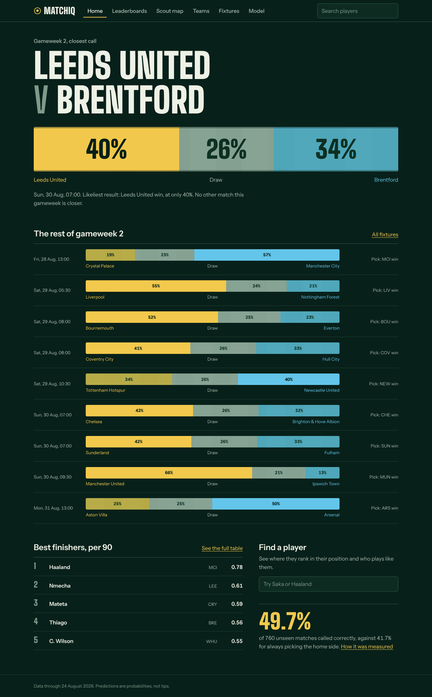
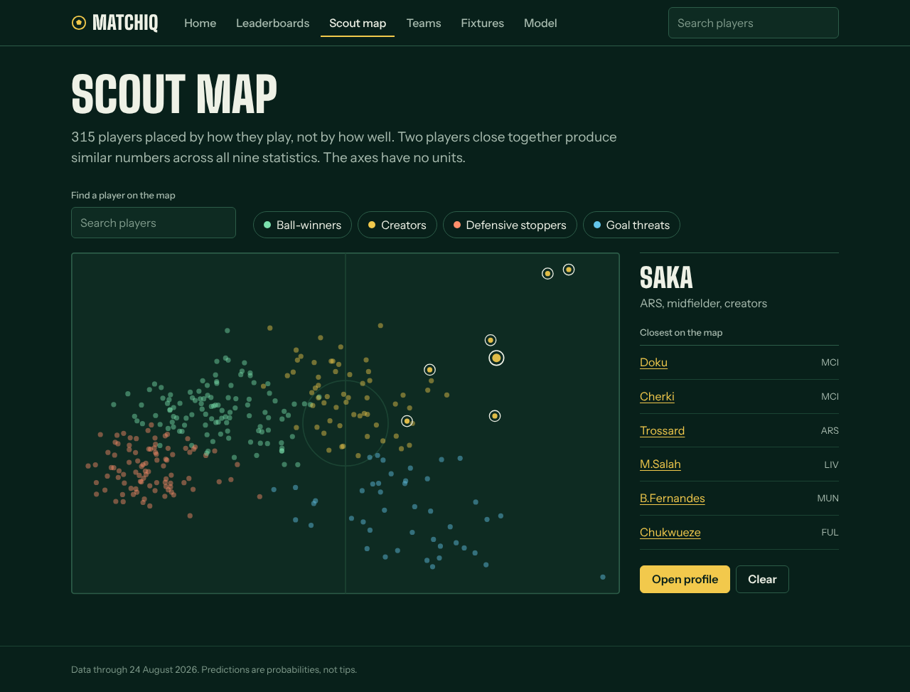
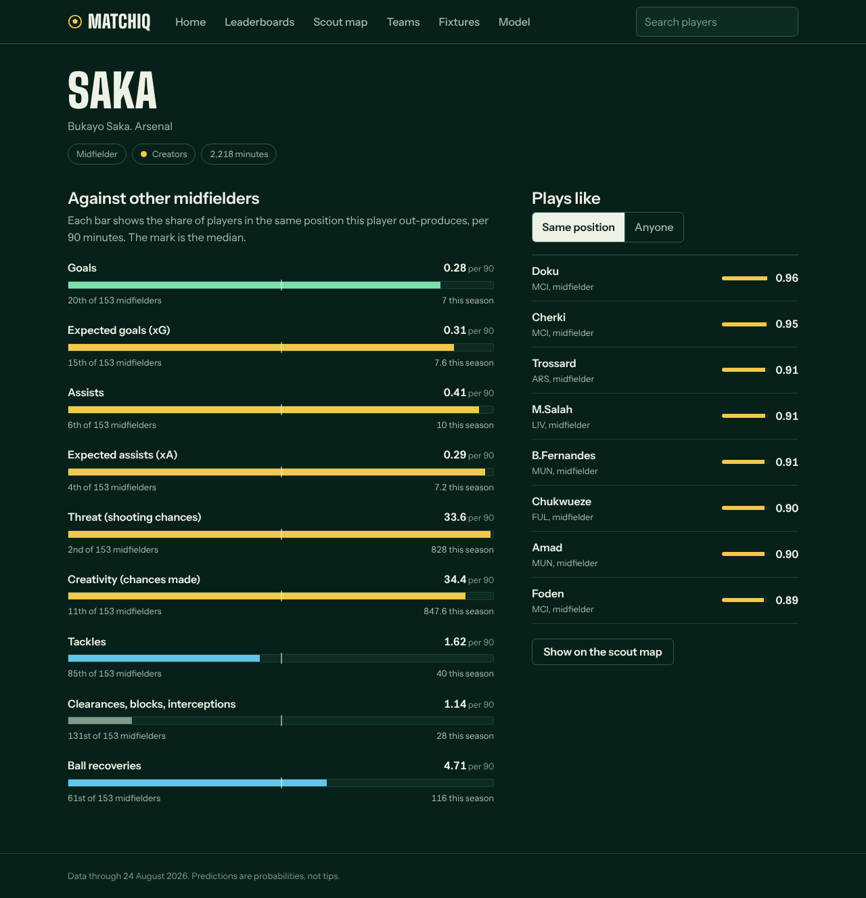
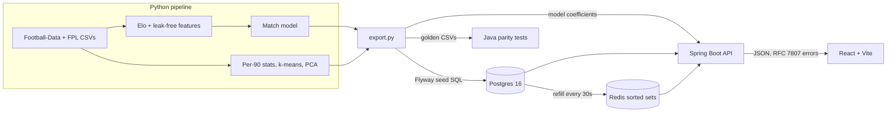
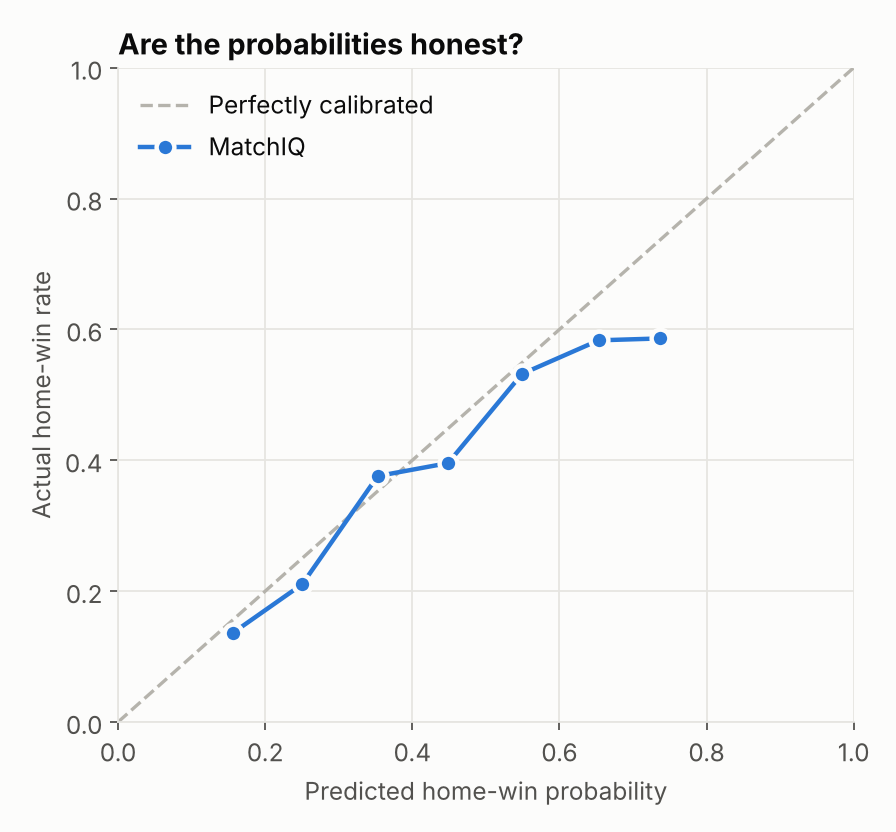

# MatchIQ

Premier League player leaderboards, "who plays like him?" search, and win/draw/loss probabilities for every fixture. A Python pipeline does the data science, a Spring Boot service serves it from Postgres and Redis, and a React app sits on top.



## What it does

- **Leaderboards.** Nine per-90 statistics, ranked across all 315 players with 900+ minutes, or within defenders, midfielders or forwards. Ties are ranked properly (1, 2, 2, 4).
- **Plays like.** Pick a player and see the nearest players by playing style, from the cosine similarity of standardised per-90 stats. Each player's profile also shows every stat as a percentile and a rank among players in the same position.
- **Scout map.** All 315 players on one plane (PCA of the same nine stats), coloured by k-means playing style: ball-winners, creators, defensive stoppers, goal threats.
- **Match predictions.** Probabilities for all 380 fixtures of 2026-27, plus a "pick any two clubs" predictor that calls the same model the fixtures were scored with.
- **An honest model page.** Every model I tried, scored on matches it never saw, including the ones that lost.

| Scout map | Player profile |
|---|---|
|  |  |

## Architecture



The pipeline trains offline and writes everything the service needs: a Flyway seed migration, the model's coefficients as a properties file, and golden CSVs of expected answers. The service loads the data into Postgres (the source of truth) and keeps the leaderboards in Redis sorted sets. Nothing in the service calls Python.

## Run it

**Everything, with Docker:**

```bash
docker compose up --build        # then open http://localhost:3000
```

**Frontend only, no backend needed.** The mock API serves the same JSON the real service does:

```bash
cd frontend && npm ci
npm run mock                      # terminal 1: mock API on :8787
npm run dev                       # terminal 2: app on :5173
```

**Frontend against the real backend:**

```bash
docker compose up postgres redis -d
(cd backend && mvn spring-boot:run)                  # API on :8080
(cd frontend && VITE_API_TARGET=http://localhost:8080 npm run dev)
```

**Regenerate the data from scratch** (needs Python 3.12):

```bash
pip install -r pipeline/requirements.txt
python pipeline/src/export.py     # rewrites the seed SQL, model file and golden CSVs
```

To host the frontend separately (for example on Vercel), set `VITE_API_BASE` to the API's URL at build time and add that origin to the backend's `CORS_ALLOWED_ORIGINS`.

## Design decisions

**Leaderboards in Redis sorted sets, with Postgres as the fallback.** A leaderboard is a sorted set per statistic and position. A player's rank is the count of members with a strictly greater score plus one (`ZCOUNT key (score +inf`), which is what makes ties come out right. Boards are rebuilt into a temporary key and swapped in with `RENAME`, so a reader never sees a half-built board. Redis commands time out after 500 ms, and if Redis is slow or down the same ranking is computed in Postgres and a counter (`matchiq_leaderboard_fallback_total`) records it. Readiness depends on the database only, so losing Redis degrades the service without getting it restarted.

**One source of truth, and a test that proves two languages agree.** The maths exists twice: pandas in the pipeline and Java in the service. The pipeline writes golden CSVs (predictions, similarity neighbours, leaderboards) and the Java tests assert the service reproduces them to 1e-9. Both sides round the same way, so a drift in either shows up as a failing test instead of a wrong number on screen.

**Match model in plain Java.** The chosen model is multinomial logistic regression over the Elo difference, so serving it is a softmax over `coefficient × x + intercept`. That needs no Python at runtime and no model-serving dependency, and the live `/predict` endpoint is checked against the precomputed fixture probabilities.

**Immutable snapshots for the in-memory data.** Reference data (the nine stats, the model, the similarity vectors) is held in one immutable snapshot that is swapped atomically on reload. A concurrency test hammers reads during swaps and fails on any torn read. Similarity search is O(n log k): a bounded min-heap over unit-length z-score vectors.

**SQL lives in `.sql` files, not string concatenation.** Each query is a resource file run through `JdbcClient`, so it can be read, formatted and tested as SQL.

**The API's shapes are a contract.** Responses are Java records. The frontend is built against a mock API, and `npm run check:contract` parses the records and fails CI if the mock's JSON differs in a field name or type. Errors are RFC 7807 problem details; every response has an `X-Request-Id` that also appears in the logs, and ETags let clients skip unchanged payloads.

**Leak-free features.** Each match's features are computed from earlier matches only. A test proves it: it rebuilds the features from a truncated history and from a history with a later result changed, and requires the earlier rows to be identical.

## The numbers

Trained on 3,420 matches (2015-16 to 2023-24). The model was chosen on a validation season (2023-24), then scored once on the 760 matches of 2024-25 and 2025-26, which it had never seen.

| Model | Right result | Log loss (lower is better) |
|---|---|---|
| Always pick the home side (baseline) | 41.7% | 1.083 |
| **Elo rating only (in use)** | **49.7%** | **1.008** |
| Logistic regression, 24 features | 49.1% | 1.014 |
| XGBoost, 24 features | 50.1% | 1.026 |

- The model beats the home-side baseline by about 8 points on two seasons it never saw.
- XGBoost gets 3 more matches right out of 760, but its probabilities are worse. That difference is luck-sized, so the simpler Elo model is the one in use. Twenty-three form features (recent points, goals, shots, home and away splits) did not beat Elo alone on validation.
- Draws are the weak spot: the model almost never names a draw as the single likeliest result, though its draw probabilities are sensible.
- The test seasons were unusually hard for anyone: home sides won only 41% and 43% of games, against about 45% in earlier seasons.



## Tests

| Where | What | Run |
|---|---|---|
| `backend/src/test/java/dev/matchiq/core` | Softmax model, similarity index, rank and tie handling, in-memory and failover leaderboards, snapshot concurrency, parity with the Python goldens | `mvn test` |
| `backend/src/test/java/dev/matchiq/ApiIntegrationTest.java` | Whole app against real Postgres and Redis containers (Testcontainers): data loads, leaderboards match Python, error responses, and the fallback when Redis is stopped mid-test. Skipped when Docker isn't available | `mvn verify` |
| `pipeline/tests` | Elo and feature maths, no-future-leakage | `python -m pytest pipeline/tests` |
| `frontend/src` | Formatting and chart helpers | `npm test` |
| `frontend/mock-api` | Mock API against the Java records | `npm run check:contract` |

GitHub Actions (`.github/workflows/ci.yml`) runs all of it on every push: it regenerates the seed data and goldens from the pipeline, then runs the Java tests against them.

## Repository layout

```
pipeline/   Python: data, features, models, scouting, charts, export.py (the hand-off to the backend)
backend/    Spring Boot 3 (Java 21): api, service, store, core (pure logic), SQL, Flyway migrations
frontend/   React + Vite + TypeScript, plus the mock API
docs/       API reference and screenshots
```

See [docs/api.md](docs/api.md) for every endpoint.

## Not built yet

- **gRPC.** A second interface to the same services (the leaderboard and prediction calls) is the natural next step.
- **Kubernetes manifests.** The service already has liveness and readiness probes, graceful shutdown and Prometheus metrics; it needs the manifests.
- **Ask MatchIQ**, a chatbot over the predictor and the scout, was in the first version's plan and is not part of this one.

## Data

Match results from [football-datasets](https://github.com/datasets/football-datasets) (Football-Data.co.uk), player statistics and fixtures from [vaastav/Fantasy-Premier-League](https://github.com/vaastav/Fantasy-Premier-League) and the official Fantasy Premier League API. Predictions are probabilities, not betting advice.
